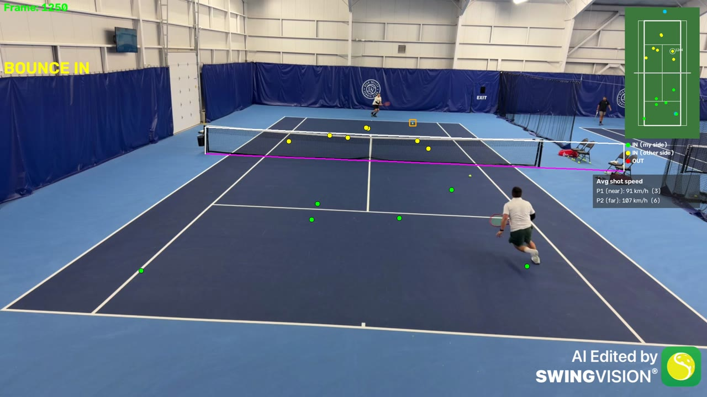

# Tennis Analysis Project

Computer vision pipeline that takes a tennis match video and finds the players, the ball, the court and the net. It then detects every **bounce** (IN or OUT), **net hits** and the **average shot speed of each player**, and draws all of it on the video and on an accurate top-down mini court.



*Green dots = IN on my side, yellow = IN on the other side, red = OUT. The pink line is the detected bottom of the net. Top right is the mini court with every bounce in its real court position.*

This project started from [abdullahtarek/tennis_analysis](https://github.com/abdullahtarek/tennis_analysis) and builds a lot on top of it (see [What's new](#whats-new-compared-to-the-original-repo)).

---

## What's new compared to the original repo

### 1. Bounce detection
- Finds bounces from the ball path (change in the ball's vertical direction), looking in a window of frames before each hit.
- Fits two curves around each candidate point and keeps only real "kinks" in the path. Physics checks (speed, direction, position on court) remove false bounces.
- Settings scale with the video's fps and resolution, so it works on 30 fps / 720p and 60 fps / 1080p videos alike.
- Game rule: only **one bounce per side** until the ball crosses the net. A second bounce on the same side shows **POINT OVER**.

### 2. IN / OUT for singles
- Every bounce is mapped to real court meters and checked against the singles lines (with a small line tolerance).
- Green = IN on my side, yellow = IN on the other side, red = OUT (with how far out it landed).

### 3. Homography from the inner 4 court points
- The original uses the court keypoints directly. Here the court is built with a **homography from the 4 inner keypoints** (8, 9, 10, 11: where the service lines meet the singles sidelines).
- These points are visible in more camera angles than the outer corners, which often fall outside the frame.
- The full court (all lines, the net, the baselines) is rebuilt from those 4 points in real court meters (10.97 m x 23.76 m).
- **Court refinement:** the 4 points are fine-tuned so the drawn court lines sit exactly on the real white lines in the video. This fixes small keypoint model errors.

### 4. Net detection
- Finds the white net tape in the image itself, so it works when the camera is tilted or not straight.
- Finds the net posts and the bottom of the net. The net then anchors the court fit.

### 5. Net hits
- A shot counts as a net hit only when the ball doesn't cross the net: either there is no next hit for about 50-60 frames, or the ball stays on the hitter's side.

### 6. Shot speed per player
- Speed = distance from the hitter's feet to where the ball bounces (in real meters) / flight time.
- Average shot speed for each player (P1 near, P2 far) is shown on screen.

### 7. Accurate mini court
- Bounces are mapped through the homography, so their mini court position matches where they actually landed (for example in no man's land).

### 8. Better ball tracking
- **Moving ball only:** balls lying still on the court are found and ignored, so only the ball in play is tracked.
- **WASB ball model:** an optional ball detector ([WASB-SBDT](https://github.com/nttcom/WASB-SBDT)) that looks at 3 frames at once. It finds blurry, fast balls much better. On one test video it found the ball in 91% of frames, compared with about 10% for the YOLO ball model.

### 9. Players and speed
- The 2 players are picked by where they stand on the court, so line judges and people on other courts are ignored.
- Runs on Apple GPU (MPS), CUDA or CPU, and reads the video frame by frame to save memory.

---

## Project structure

```
main.py                      # runs the whole pipeline
trackers/
    player_tracker.py        # YOLO player detection + picking the 2 players by court position
    ball_tracker.py          # YOLO ball detection, interpolation, hit (shot) frames
    wasb_ball_tracker.py     # WASB ball detection (3 frames at once)
    ball_candidates.py       # keeps the moving ball, ignores balls lying on the court
court_line_detector/         # court keypoint model (from the original repo)
court_homography/
    court_homography.py      # homography from keypoints 8-11, image <-> court meters, net
    net_detector.py          # net tape, posts and bottom from the image
    court_fitter.py          # moves the 4 points so the court lines match the white lines
ball_events/
    ball_event_detector.py   # bounces, IN / OUT, one-bounce-per-side rule, net hits
    hitter.py                # which player hit the ball
    shot_speed.py            # shot speed and average per player
top_down_court/              # output video with the mini court, bounce dots and speeds
mini_court/                  # original mini court (from the original repo)
constants/                   # court size in meters and other settings
utils/                       # curve fitting, video helpers, device choice
wasb/                        # WASB model code (MIT license, NTT Communications)
runpod/                      # scripts to run WASB on a RunPod GPU
training/                    # ball detector training notebook
```

---

## Setup

```bash
git clone https://github.com/523vishwanath/Tennis_Analysis_Project.git
cd Tennis_Analysis_Project
python3 -m venv .venv
source .venv/bin/activate
pip install -r requirements.txt
```

### Model weights (not in the repo, download them)

| Model | Put it here | Download |
|---|---|---|
| Court keypoints | `models/keypoints_model.pth` | [link (original repo)](https://drive.google.com/file/d/1QrTOF1ToQ4plsSZbkBs3zOLkVt3MBlta/view?usp=sharing) |
| YOLO ball model | `models/yolo5_last.pt` | [link (original repo)](https://drive.google.com/file/d/1UZwiG1jkWgce9lNhxJ2L0NVjX1vGM05U/view?usp=sharing) |
| WASB tennis ball model | `wasb/pretrained_weights/wasb_tennis_best.pth.tar` | [link (WASB-SBDT)](https://drive.google.com/file/d/14AeyIOCQ2UaQmbZLNQJa1H_eSwxUXk7z/view) |
| YOLO player model | project root (`yolo26l.pt`) | downloads automatically with ultralytics |

## Run

1. Put your video in `input_videos/`.
2. In `main.py`, set `input_video_path` and `output_video_path`.
3. Settings at the top of `main.py`:
   - `USE_WASB = True` uses the WASB ball model, `False` uses the YOLO ball model.
   - `READ_FROM_STUB = False` runs detection on the video. After the first run, `True` reuses the saved detections in `tracker_stubs/` and is much faster.
4. Run:
   ```bash
   python main.py
   ```

The output video is saved in `output_videos_test/`. The bounces (frame, court position, IN / OUT) and net hits are printed in the terminal.

### Run WASB on a GPU (optional)

`runpod/` has a setup script and `wasb_infer.py` to run the WASB ball model on a cloud GPU such as RunPod. It saves `ball_candidates.pkl` in the same format as `tracker_stubs/`, plus a preview video.

---

## Credits

- **Original project:** [abdullahtarek/tennis_analysis](https://github.com/abdullahtarek/tennis_analysis). The base structure, player and ball tracking with YOLO, the court keypoint model and its trained weights, and the original mini court all come from there.
- **SwingVision:** thanks to [SwingVision](https://swing.tennis/) for the tracked match videos used to test this project. The videos are not included in this repo.
- **WASB-SBDT:** the WASB ball model and its tennis weights are from [nttcom/WASB-SBDT](https://github.com/nttcom/WASB-SBDT) (MIT License, Copyright (c) 2023 NTT Communications Corporation). Paper: *Widely Applicable Strong Baseline for Sports Ball Detection and Tracking*, Tarashima et al., BMVC 2023 ([arXiv:2311.05237](https://arxiv.org/abs/2311.05237)).
- **Ultralytics YOLO** for player detection.

## Author

**Vishwanath Reddy Ninganolla**  
[GitHub](https://github.com/523vishwanath) · [LinkedIn](https://www.linkedin.com/in/vishwanathninganolla)
